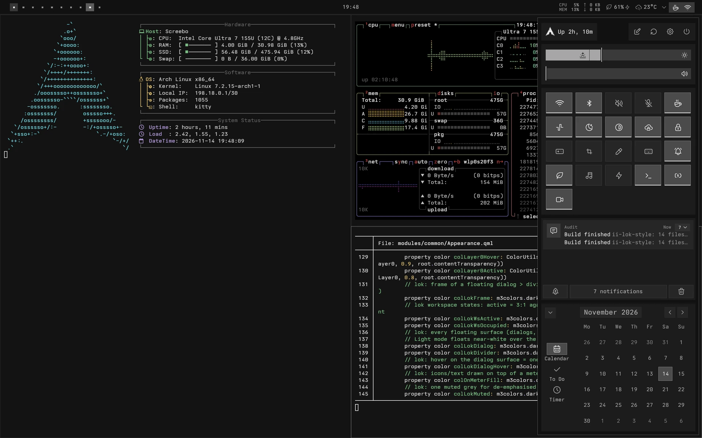
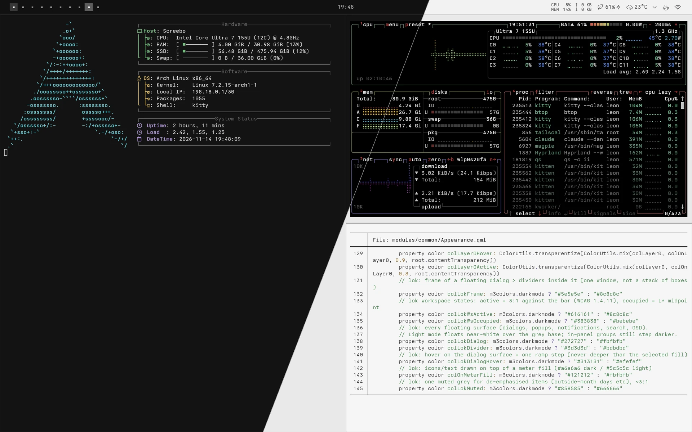
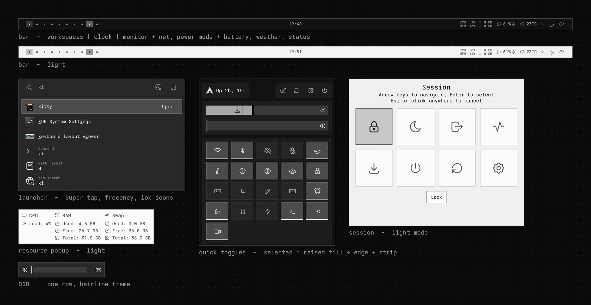

<div align="center">

# lok · illogical-impulse

**A greyscale, square, hairline rice of end-4's illogical-impulse — on an ASUS Chromebook running Arch.**

Hyprland · Quickshell `ii` · KDE Plasma · fingerprint everywhere



</div>

This is a private fork of [end-4/dots-hyprland](https://github.com/end-4/dots-hyprland).
The Quickshell shell, Hyprland config and installer are end-4's. On top of that it adds:

- **lok** — a style switch that turns Material You into a quiet, tool-like look borrowed from my
  web desktop [lok-computer](https://github.com/l3ony2k/lok-computer): zero saturation, no rounded
  corners, 1 px lines, monospace type, no bounce.
- **Shell features** I use every day — a reworked bar, my own quick toggles (Mihomo, Tailscale,
  SSH from LAN, charge limit, camera kill switch, keep-awake) and a faster launcher.
- **The machine** — everything it took to make an ASUS CX54 Chromebook (`SCREEBO`) a good Linux
  laptop: fingerprint unlock, hibernate, standby power, a battery charge limit.

Set `appearance.style` to `material` (ii Settings → Style) and you get upstream's look back. Every lok
change is gated on that switch.



## The lok style



| | Rule |
|---|---|
| **Colour** | A fixed greyscale palette, not wallpaper-derived. Saturated colour is only for meaning: terminal ANSI colours, warnings, the red of a hot CPU. Dark is the default; light is tuned to the same contrast. |
| **Layers** | The higher a surface floats, the lighter it is (dark) or the closer to white (light). Bar `#121212` → panel groups → floating dialogs `#272727` / `#fbfbfb`. |
| **Lines** | Every frame and divider is exactly one *physical* pixel. The width comes from the window's real scale (1.333 here), not the integer scale Quickshell reports. Frames are drawn inside the item, so no side gets clipped. Dividers are dimmer than the outer frame, so a dialog reads as one window. |
| **Selection** | Raised fill + a bright 1 px edge (+ a 2 px status strip on tiles). Selection always beats hover: hovering a selected item leaves it exactly as it was. |
| **Hover** | One step up the grey ramp. No ripple, no frame change; press fills immediately. |
| **Shape** | Zero radius everywhere: buttons, sliders, workspace dots, the Hyprland windows (no gaps, 1 px border, no shadow). |
| **Type & icons** | Ioskeley Mono (Medium for UI text). Icons are [Tabler](https://tabler.io/icons) outline glyphs packed into a font with Material Symbols ligatures, so all 415 icon names in ii map to a line icon and the originals stay one switch away. |
| **Motion** | Short ease-out curves, no overshoot. |
| **Wallpaper** | A generated dot grid, dark and light; it follows the mode. |

Plasma gets the same look through a generated Plasma theme, Aurorae window decoration and colour
scheme (`asus/lok/plasma/`), so the floating-window session matches the tiling one.

## Shell changes

- **Bar** — workspaces left, the clock centred on the screen, then a two-line monitor
  (`CPU 7% ↑ 0 KB` / `MEM 13% ↓ 0 KB`), power mode merged with the battery (click to cycle
  Power saver / Balanced / Performance), weather. Status icons only appear when something differs
  from normal (muted, Bluetooth connected, keep-awake on). Hover popups sit centred under their item.
- **Quick toggles** — Mihomo (mode, node, TUN, traffic, dashboard), Tailscale, SSH from LAN, charge
  limit 60 / 80 / 100 %, camera kill switch, keep-awake that also keeps the lid from suspending.
- **Launcher** — a Super tap opens it without spawning a client process. The empty query lists all
  apps by frecency, and the last query and its results come back for five minutes.
- **Touch** — touchpad pixel scrolling in shell lists is scaled to match the apps
  (`interactions.scrolling.touchpadPixelGain`).
- **Lock** — hyprlock with fingerprint and password at the same time, via a small fprintd D-Bus shim.

## The machine

ASUS Chromebook CX54 (`SCREEBO`, Intel Core Ultra 7 155U) with Arch Linux, systemd-boot UKIs.

| Area | What was done | Where |
|---|---|---|
| Fingerprint | ChromeOS FPMCU driven by [rust-fp](https://github.com/kaukauk/rust-fp) with an FP_INFO v2 patch for [crosec-rs](https://github.com/ChocolateLoverRaj/crosec-rs); a PAM module that runs password and finger in parallel (sudo, polkit, KDE lock); an fprintd-compatible D-Bus shim for hyprlock | `asus/src/fingerprint/` — `upstream-worktree/` rebuilds the exact sources from upstream |
| Hibernate | `e820-hibfix` DKMS module, memmap cmdline, 24 h suspend-then-hibernate on battery | `asus/src/e820-hibfix-1.2`, `asus/system/` |
| Power | S0ix standby, ASPM powersupersave, no idle suspend on AC, debounced power key | `asus/system/`, `asus/src/` |
| Battery | `battery-limit set 60\|80\|100`, restored at boot; also an ii quick toggle and a Plasma widget | `asus/src/battery-limit/` |
| Keyboard | ChromeOS top row and layout via keyd | `asus/system/etc/keyd/` |

`asus/system/` holds copies of the changed system files; they are restored by hand, not by setup.
Reasons and history are in `asus/ops/` and in the ops log on the machine.

## Layout

```
dots/                  upstream tree, with this fork's edits committed on top
asus/
  lok/                 lok: README, icon font + builder, wallpapers, plasma/ generators, patches/
  src/                 sources: fingerprint, e820-hibfix, battery-limit, idle-suspend, lid / power key
  system/              copies of /etc and /boot files changed on the machine
  snapshots/           restore point from before lok (restore.sh)
  ops/                 write-ups of the bigger investigations
  RUNBOOK-updates.md   how to update the system and these dots safely
.github/assets/lok/    the screenshots on this page
```

## Updating

```sh
cd ~/dots-hyprland
git fetch upstream
git rebase upstream/main                   # resolve conflicts in our commits
git push --force-with-lease origin main
./setup exp-update -s --non-interactive keep
```

`material-shapes` is a submodule, so its lok square shape lives in
`asus/lok/patches/material-shapes-lok-square.patch`; re-apply it if an update resets the submodule.
To go back to the look from before lok: tag `pre-lok-style-2026-11-12` plus
`asus/snapshots/2026-11-12-pre-lok/restore.sh`, or just set the style to `material`.

## Credits

- [end-4/dots-hyprland](https://github.com/end-4/dots-hyprland) — illogical-impulse, everything this builds on (GPL-3.0).
- [Tabler Icons](https://tabler.io/icons) (MIT), Ioskeley Mono, [Quickshell](https://quickshell.outfoxxed.me/).
- [rust-fp](https://github.com/kaukauk/rust-fp) and [crosec-rs](https://github.com/ChocolateLoverRaj/crosec-rs) for the fingerprint stack.
