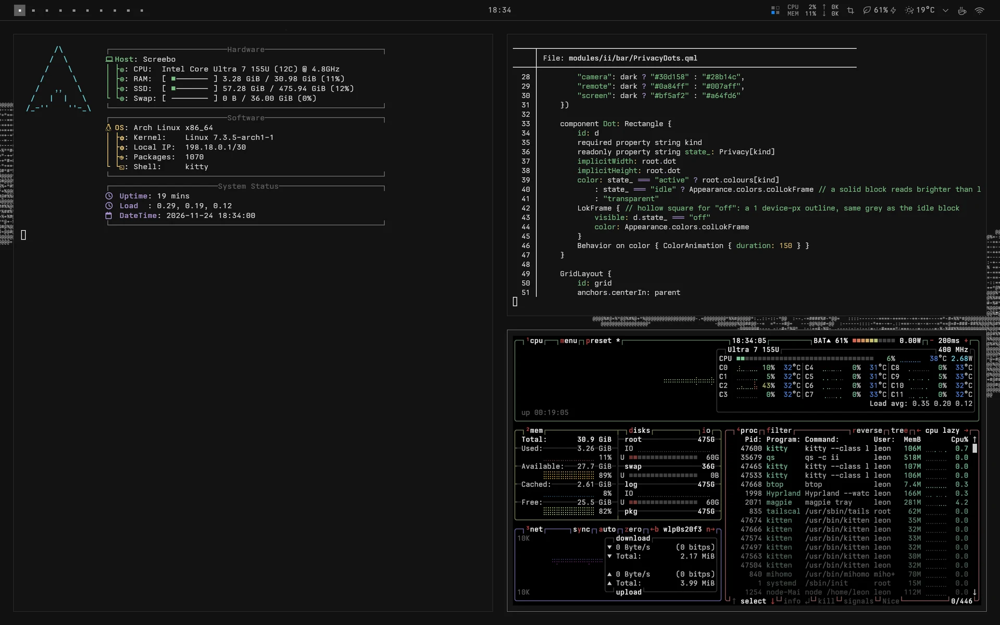
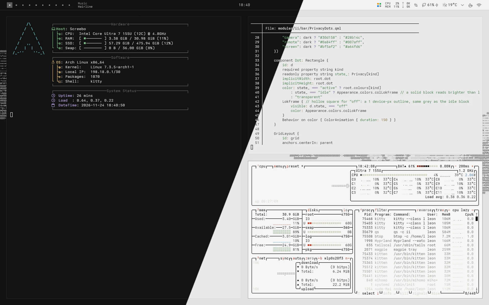
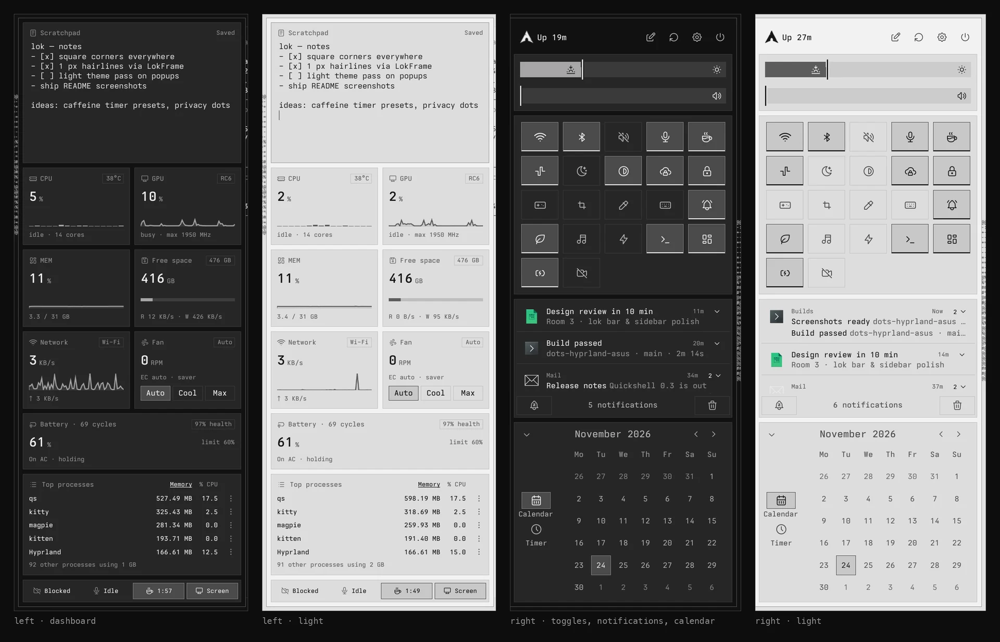
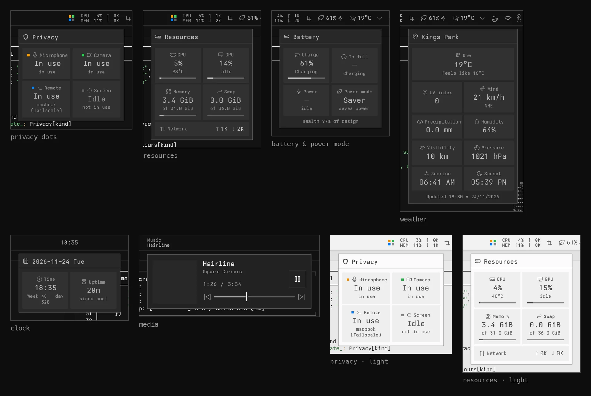
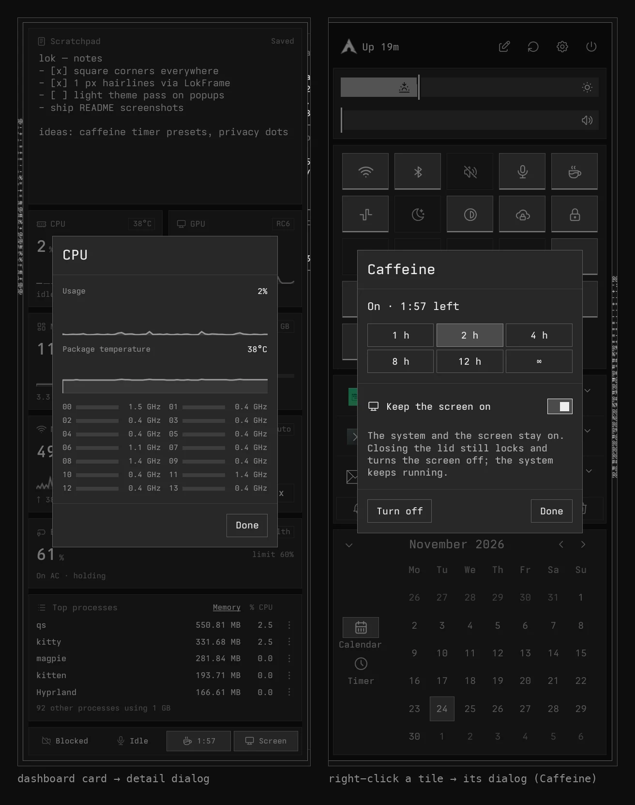
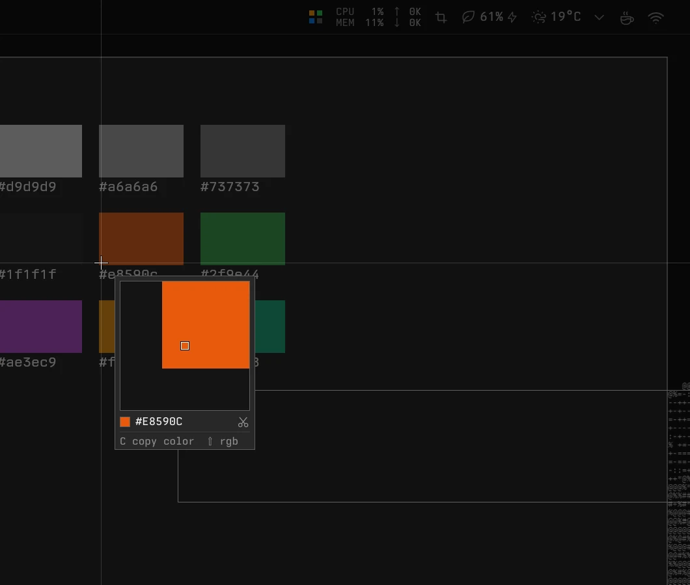

<div align="center">

# lok · illogical-impulse

**A greyscale, square, hairline rice of end-4's illogical-impulse, on an ASUS Chromebook running Arch.**

Hyprland · Quickshell `ii` · KDE Plasma · fingerprint everywhere



</div>

This is a private fork of [end-4/dots-hyprland](https://github.com/end-4/dots-hyprland), and it is the whole
dotfiles repo of one laptop. The Quickshell shell, the Hyprland config and the installer are end-4's. I added
three things on top:

- lok, a style switch that turns Material You into the quiet, tool-like look of my web desktop
  [lok-computer](https://github.com/l3ony2k/lok-computer): no saturation, no rounded corners, 1 px lines,
  monospace type, no bounce.
- Shell features I use every day: a reworked bar with privacy dots, card popups, my own quick toggles,
  colour picking inside the screen snip, and a faster launcher.
- The machine: what it took to make an ASUS CX54 Chromebook (`SCREEBO`) a good Linux laptop, from fingerprint
  unlock and hibernate to standby power and a charge limit, plus a restore path for a fresh Arch install.

Set `appearance.style` to `material` (ii Settings, Style) to get upstream's look back. Every lok change checks
that switch.



## The lok style

| | Rule |
|---|---|
| Colour | A fixed greyscale palette that ignores the wallpaper. Colour only carries meaning: terminal ANSI colours, warnings, the red of a hot CPU, the privacy dots. Dark is the default and light is tuned to the same contrast. |
| Layers | The higher a surface floats, the lighter it is in dark mode and the closer to white in light mode. Bar `#121212`, then cards on the sidebars, then floating dialogs `#272727` / `#fbfbfb`. |
| Lines | Every frame and divider is one *physical* pixel. The width comes from the window's real scale (1.333 here), not the integer scale Quickshell reports, and frames are drawn inside the item so no side gets clipped. Dividers are dimmer than the outer frame, so a dialog reads as one window. |
| Selection | A raised fill and a bright 1 px edge, plus a 2 px status strip on quick toggle tiles. Hovering a selected item leaves it as it was. |
| Hover | One step up the grey ramp. No ripple and no frame change; a press fills at once. |
| Shape | Zero radius on everything: buttons, sliders, workspace dots, windows. |
| Type and icons | Ioskeley Mono (Medium for UI text). Icons are [Tabler](https://tabler.io/icons) outline glyphs packed into a font with Material Symbols ligatures, so all 415 icon names in ii map to a line icon and the originals stay one switch away. |
| Motion | Short ease-out curves with no overshoot. |
| Wallpaper | A dot grid and the ASCII hands of [wallhaven 7jmgey](https://wallhaven.cc/w/7jmgey), each in a dark and a light version that follow the mode. |

Plasma gets the same look from a generated Plasma theme, an Aurorae window decoration and a colour scheme
(`asus/lok/plasma/`), so the floating-window session matches the tiling one.

## Shell changes



The bar has workspaces on the left, the clock centred on the screen, and on the right four privacy dots, a
two-line monitor (`CPU 7% ↑ 0 KB` / `MEM 13% ↓ 0 KB`), power mode merged with the battery (click to cycle
Power saver, Balanced and Performance), weather, the tray and status icons. Status icons only show when
something differs from normal: muted, Bluetooth connected, Caffeine on. The bar also works vertically on either
edge.

The privacy dots work like the macOS indicators. Mic is orange, camera green, remote (SSH) blue and screen
sharing purple while in use; grey means idle and an outline means the device is off. Hovering any bar item
opens a card popup centred under it.



The quick toggles add Mihomo (mode, node, TUN, traffic, dashboard), Tailscale, SSH from LAN, a 60 / 80 / 100 %
charge limit, a camera kill switch, window gaps (none, small, large; with none, neighbours share one border) and
Caffeine. Caffeine keeps the machine awake for 1 to 12 hours or indefinitely, optionally with the screen on, and
turns itself off at 10 % battery. Right-click any tile for its settings dialog.



Super+Alt+S opens the screen snip with a loupe: it shows the pixel grid under the cursor, C copies the colour as
`#RRGGBB` (Shift for `rgb()`), and the arrow keys move by one pixel.



Super+Space opens search without spawning a client process. An empty query lists all apps by frecency, and the
last query and its results come back for five minutes. Touchpad scrolling in shell lists is scaled to match the
apps (`interactions.scrolling.touchpadPixelGain`). hyprlock takes the fingerprint and the password at the same
time, through a small fprintd D-Bus shim.

More screenshots: [asus/lok/README.md](../asus/lok/README.md#gallery).

## The machine

ASUS Chromebook CX54 (`SCREEBO`, Intel Core Ultra 7 155U), Arch Linux, systemd-boot UKIs.

| Area | What was done | Where |
|---|---|---|
| Fingerprint | ChromeOS FPMCU driven by [rust-fp](https://github.com/kaukauk/rust-fp) with an FP_INFO v2 patch for [crosec-rs](https://github.com/ChocolateLoverRaj/crosec-rs); a PAM module that runs password and finger in parallel (sudo, polkit, KDE lock); an fprintd-compatible D-Bus shim for hyprlock | `asus/src/fingerprint/` (`upstream-worktree/` rebuilds the exact sources from upstream) |
| Hibernate | `e820-hibfix` DKMS module, memmap cmdline, suspend-then-hibernate after 24 h on battery | `asus/src/e820-hibfix-1.2`, `asus/system/` |
| Power | S0ix standby, ASPM powersupersave, no sleep on AC even with the lid closed, debounced power key | `asus/system/`, `asus/home/.local/bin/` |
| Battery | `battery-limit set 60\|80\|100`, restored at boot; also a quick toggle and a Plasma widget | `asus/src/battery-limit/` |
| Keyboard | ChromeOS top row and layout via keyd | `asus/system/etc/keyd/` |

## How the repo maps to the machine

The repo lives at `~/.dotfiles`. Configs I edit by hand (`~/.config/quickshell/ii`, `~/.config/hypr`, the zsh
files, helper scripts) are symlinks into it, so editing the live file edits the repo. Files that programs rewrite
themselves, such as KDE's rc files and ii's `config.json`, are copied in and out by `asus/home-sync.sh`. `$HOME`
follows the XDG directories where the tools allow it.

```
dots/                  upstream tree, with this fork's edits committed on top
asus/
  README.md            how the repo maps to the machine (links, copies, secrets, XDG)
  RESTORE.md           rebuild everything on a fresh Arch install (install.sh runs the stages)
  RUNBOOK-updates.md   update the system and merge upstream end-4
  links.sh             symlink the hand-edited configs into $HOME
  home-sync.sh         pull | diff | restore for program-written files; also writes packages/
  system-diff.sh       compare the copies in system/ with /etc, /usr/local, /boot
  home/                the $HOME side: zsh, git, scripts, rime, herdr, LibreWolf, KDE, fonts
  system/              copies of the system files changed on the machine
  packages/            pacman.txt and aur.txt
  src/                 local builds: fingerprint, e820-hibfix, battery-limit, camera tile patches
  lok/                 the style: icon font and builder, wallpapers, Plasma theme, screenshots, demo/
  ops/, snapshots/     write-ups of the bigger investigations; the pre-lok restore point
```

## Updating

Upstream changes come in as a git merge. end-4's `./setup exp-update` would copy files over the symlinks, so
`setup` refuses it on this machine.

```sh
cd ~/.dotfiles
git fetch upstream
git log --oneline HEAD..upstream/main      # read what changed first
git tag pre-merge-$(date +%Y%m%d)
git merge upstream/main
./setup install --skip-allfiles            # only when sdata/ (dependencies) changed
git push origin main
```

Checks after a merge and the list of upstream files we patch are in `asus/RUNBOOK-updates.md`. To go back to the
look from before lok, set the style to `material`, or use the tag `pre-lok-style-2026-11-12` with
`asus/snapshots/2026-11-12-pre-lok/restore.sh`.

## Credits

- [end-4/dots-hyprland](https://github.com/end-4/dots-hyprland): illogical-impulse, which all of this builds on (GPL-3.0).
- [Tabler Icons](https://tabler.io/icons) (MIT), Ioskeley Mono, [Quickshell](https://quickshell.outfoxxed.me/).
- [rust-fp](https://github.com/kaukauk/rust-fp) and [crosec-rs](https://github.com/ChocolateLoverRaj/crosec-rs) for the fingerprint stack.
- The ASCII hands wallpaper is [wallhaven 7jmgey](https://wallhaven.cc/w/7jmgey).
