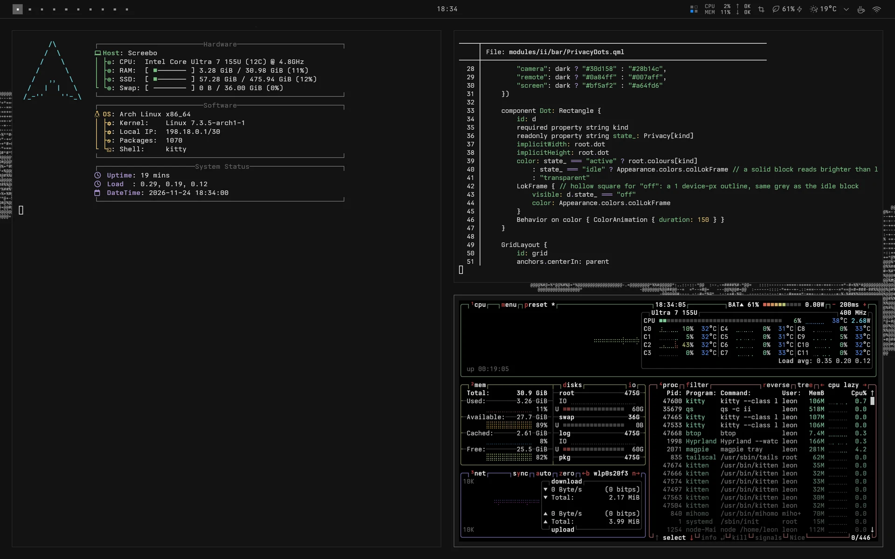
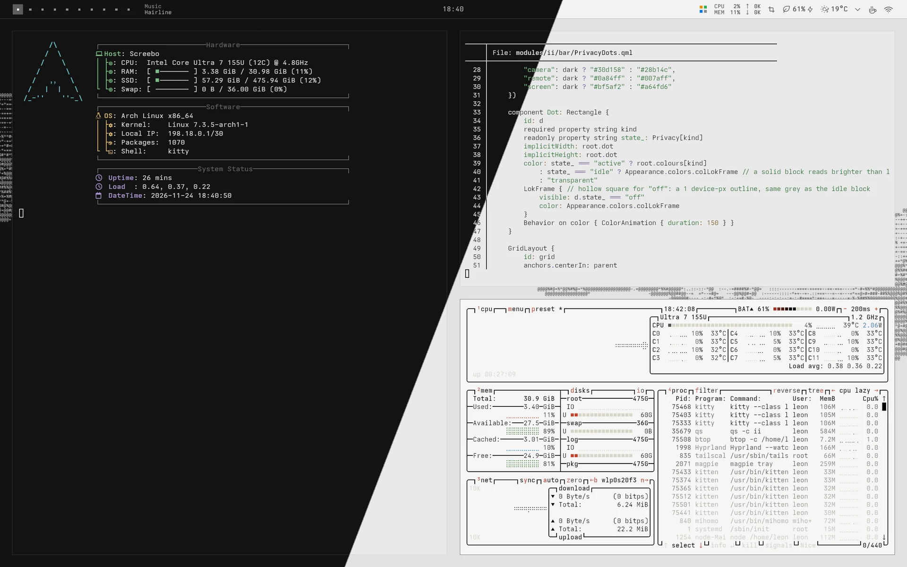

# ASUS CX54 (SCREEBO): this machine's dotfiles

More screenshots (sidebars, popups, colour pick, gaps, vertical bar): [lok/README.md](lok/README.md#gallery).

This repo (`github.com/l3ony2k/lok-desktop`) is the only dotfiles repo of the ASUS laptop, and it
lives at `~/.dotfiles`. It is a fork of [end-4/dots-hyprland](https://github.com/end-4/dots-hyprland)
(`upstream`): the illogical-impulse (ii) Quickshell desktop, restyled into the flat monochrome lok theme, plus
everything else this machine needs. The MacBook/VPS dotfiles repo (`dotfiles-sg-vps`) is not used here.

## Layout

| Path | What | How it reaches `$HOME` |
|---|---|---|
| `dots/` | end-4's tree, with this machine's edits committed on top (lok theme, ii features, hypr `custom/`) | the edited parts are symlinked by `asus/links.sh`; end-4's installer copied the rest once |
| `asus/home/` | everything in `$HOME` that end-4 does not ship: shell, git, helper scripts, rime, herdr and LibreWolf themes, KDE, ii `config.json`, fonts | hand-edited files are symlinked (`links.sh`); files that programs rewrite are copied (`home-sync.sh`) |
| `asus/system/` | copies of files under `/etc`, `/usr/local`, `/boot` | by hand; `asus/system-diff.sh` compares |
| `asus/packages/` | `pacman.txt` (official repos) and `aur.txt`, regenerated by `home-sync.sh pull` | `asus/install.sh packages` |
| `asus/src/` | sources of local builds: e820-hibfix DKMS module, fingerprint (rust-fp, PAM, fprintd shim), battery limit, camera tile patches | by hand, see `RESTORE.md` |
| `asus/lok/` | lok theme assets and notes: fonts, icons, wallpapers, Plasma theme, patches, screenshots | none |
| `setup`, `sdata/` | end-4's installer, with an asus guard (see below) | `./setup install --skip-allfiles` |

## Symlinked and copied files

`asus/links.sh` keeps the list `LINKS`. Each live path there is a symlink into this repo, so editing
`~/.config/quickshell/ii/...`, `~/.config/hypr/...`, `~/.config/zsh/.zshrc` or `~/.local/bin/ii-restart` edits
the repo directly, and `git status` shows every uncommitted change. `links.sh status` checks the links and
`links.sh apply` creates missing ones.

`asus/home-sync.sh` keeps the list `MANIFEST`: files that programs rewrite themselves (KDE rc files, ii
`config.json`, the fcitx5 profile, herdr settings). Such a program would replace a symlink with a plain file, so
these stay real files. After one changes, run `asus/home-sync.sh pull`, review `git diff` and commit;
`home-sync.sh diff` shows what drifted.

A new hand-edited file goes in `LINKS` (then `links.sh apply --adopt`), a new program-written file goes in
`MANIFEST` (then `home-sync.sh pull`). A file belongs to one list only.

## A tidy $HOME (XDG)

Programs that support it keep their files in the XDG directories instead of `~/.<name>`.
`asus/home/.config/environment.d/50-xdg-home.conf` sets `CARGO_HOME`, `RUSTUP_HOME`, `NVM_DIR`,
`NPM_CONFIG_CACHE`, `GTK2_RC_FILES` and `ICEAUTHORITY`; systemd --user, zsh, bash and Hyprland's
`custom/env.lua` all read it, so a new variable goes in that one file. `/etc/zsh/zshenv` sets
`ZDOTDIR=~/.config/zsh`, and the histories are in `~/.local/state/{zsh,bash,vim}`.

Some entries stay in `~` on purpose: `.ssh`, `.var` (Flatpak), bash's own rc files,
`.claude`/`.codex`/`.dsh`/`.omp` (vibe-usage and magpie expect them there), `.gnupg`, `.pki`, `.Xauthority`,
`.dmrc` and `.claude.json`.

## Secrets (never in this repo)

`~/.ssh`, `~/.config/mihomo/sub-url` (the Mihomo subscription URL, read by `mihomo-update-sub`),
`/etc/mihomo/config.yaml`, `~/.config/typesafe.env`, the Tailscale and gh logins, fingerprint templates.
`RESTORE.md` says where each one comes from on a new machine.

## Documents

- `RESTORE.md`: rebuild this setup on a fresh Arch install.
- `RUNBOOK-updates.md`: update the system and merge upstream end-4.
- `lok/README.md`: the lok theme and the screenshot gallery.
- Change history: `~/.local/share/claude/asus-arch-ops/` on the machine (`INDEX.md` and `entries/`).

## end-4's installer and the symlinks

`./setup exp-update`, `install-files` and a plain `install` copy end-4's files over `~/.config`, and exp-update
deletes `~/.config/hypr` first, so they would replace the symlinks with copies. A guard at the top of `setup`
refuses them while `~/.config/quickshell/ii` is a symlink. Use `./setup install --skip-allfiles` for
dependencies only, and merge upstream with git (`RUNBOOK-updates.md`, section B).
