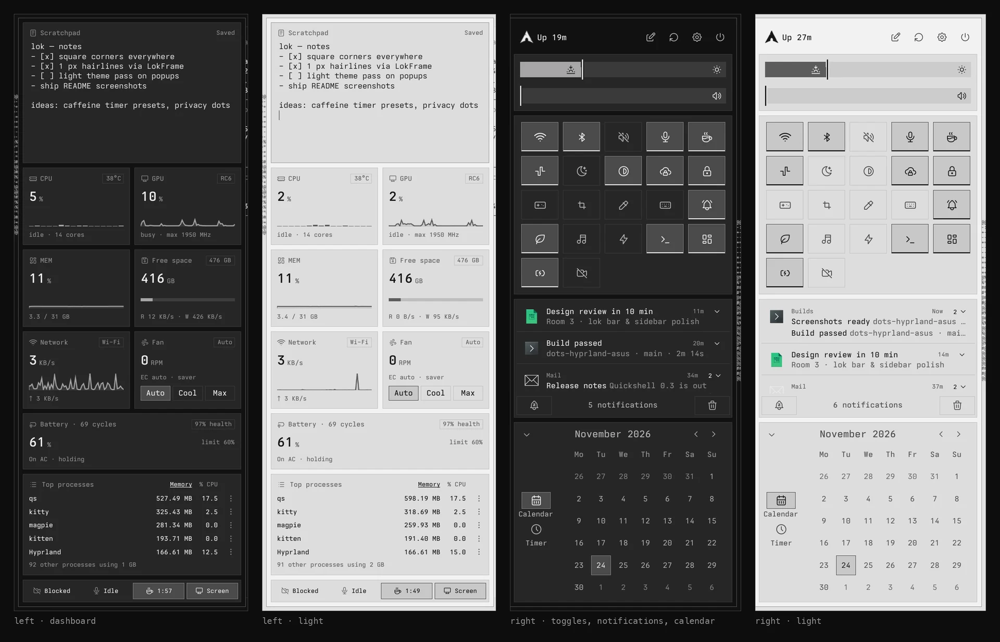

# lok style for ii (ASUS)

Greyscale, square, thin-line style layered on end-4 ii. Switch: `appearance.style` = `lok` | `material`
(ii Settings > Style, or config.json). Palette `lok` is fixed (does not follow the wallpaper).

- ii code: `Appearance.lok` gates every change; `material` keeps upstream behaviour.
- Colours: `scripts/colors/lok/lok_palette.py` + `apply-lok.sh` (called by `switchwall.sh`), also writes
  `~/.config/hypr/custom/lok.lua` (generated; rounding 0, 1 px grey border, no shadow), loaded by `custom/general.lua`.
- Icons: `fonts/LokIcons*.ttf` -> `~/.local/share/fonts/lok-icons/` (Tabler Icons 300/200, MIT) with
  Material Symbols name ligatures. Rebuild: `icon-build/build_lok_icons.py <tabler ttf> "Lok Icons" LokIcons.ttf`.
- Wallpapers (-> `~/Pictures/Wallpapers/`):
  - `wallpapers/lok-dots-{dark,light}.png` — dot grid, made for lok.
  - `wallpapers/wallhaven-7jmgey-lok.png` / `-lok-light.png` — the ASCII "Creation of Adam" hands. Source:
    wallhaven `7jmgey` (https://wallhaven.cc/w/7jmgey, 3840x2160, purple on dark; wallhaven file names are
    `wallhaven-<id>`, the id is unique). `-lok` is the greyscale version; `-lok-light` (2026-11-24) inverts it onto
    the light base: `v' = 226 - (v - 18) * 0.85` per pixel (226 = lok-dots-light background).
- Back to the previous look: tag `pre-lok-style-2026-11-12` + `asus/snapshots/2026-11-12-pre-lok/restore.sh`,
  or just set style to `material`.

## Gallery

Raw shots come from `demo/shoot.sh` (demo windows on workspace 1, mock notes/notifications, a silent fake
player, weather set to Hong Kong; everything is backed up first and restored afterwards with a sha256 check);
`demo/compose.py` crops and lays them out. Re-run both after UI changes.

**Desktop.** Bar (workspaces · now playing · clock · privacy dots, resources, screen snip, power mode + battery,
weather, tray, status), 1 px window frames, the ASCII-hands wallpaper.

**Dark and light.** Same layout; light mode swaps to the light wallpaper and every lok token.

**Sidebars.** Left: scratchpad, resource cards with history, fan mode, battery, top processes, status row
(camera, mic, Caffeine timer, keep-screen). Right: sliders, quick toggles, notifications as rows, calendar.

**Dialogs.** A dashboard card opens a detail dialog (per-core CPU, temperature); right-clicking a quick
toggle opens its settings (Caffeine: duration presets, keep the screen on).

**Bar popups.** Hover any bar item: card layout with a title rule. Privacy dots light up macOS-style:
mic orange, camera green, remote (SSH) blue, screen sharing purple; grey = idle, outline = off.

**Colour pick in the screen snip.** Super+Alt+S, hover: the loupe shows the pixel grid and the colour;
C copies `#RRGGBB`, Shift switches to `rgb()`, arrow keys move by 1 px.

**Search, session, notification, OSD.**

**Window gaps tile.** None (neighbours share one border, the focused window's on top), small, large.

**Vertical bar.** The same modules stacked on the left edge.

