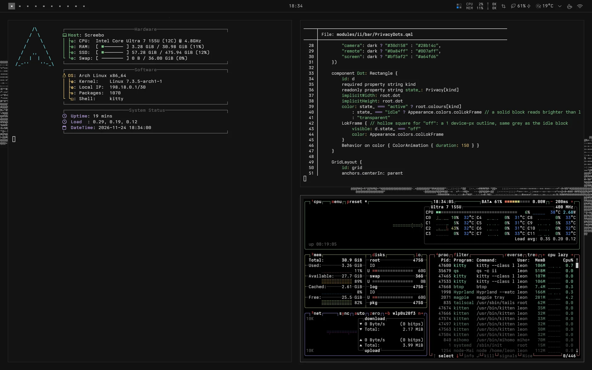
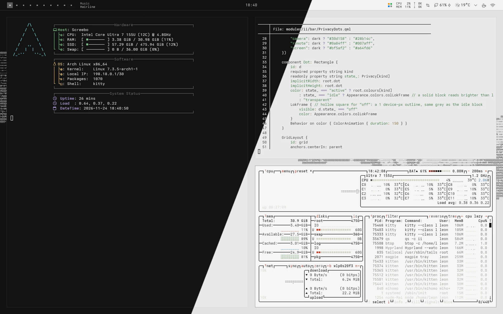
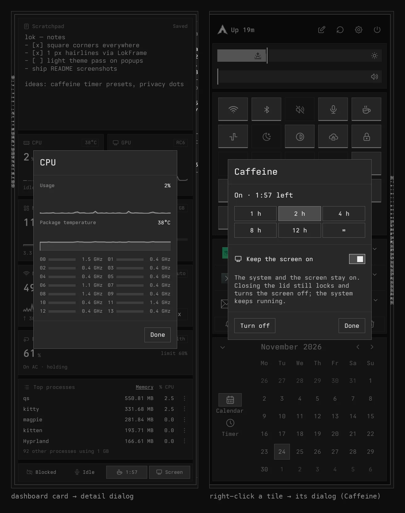
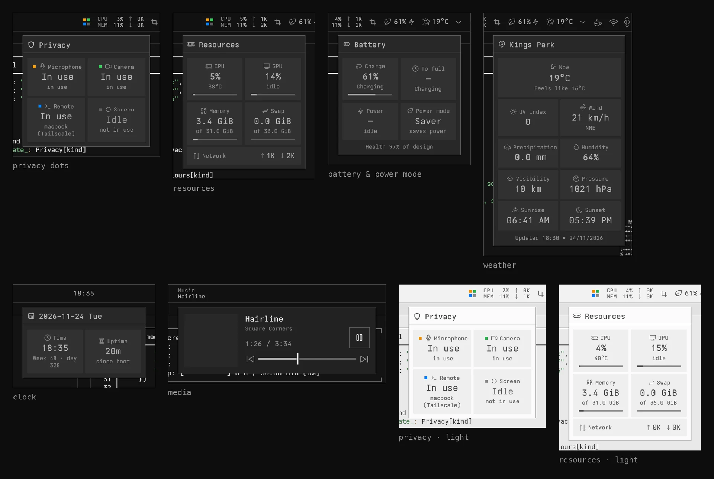
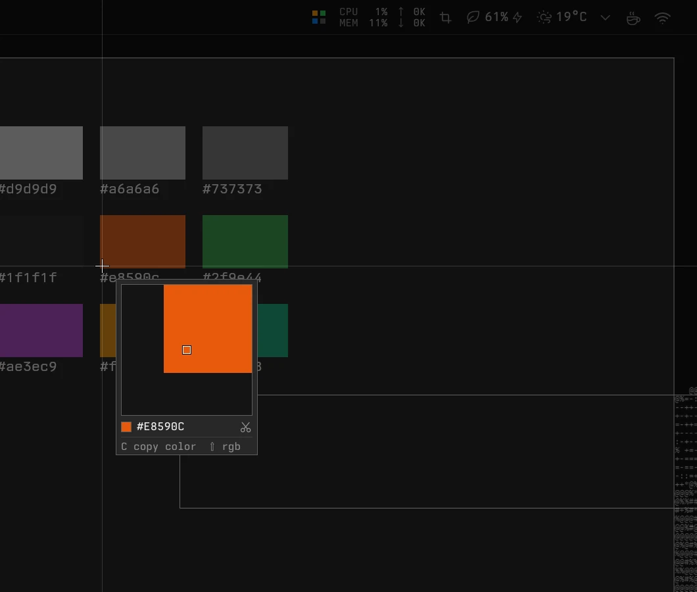
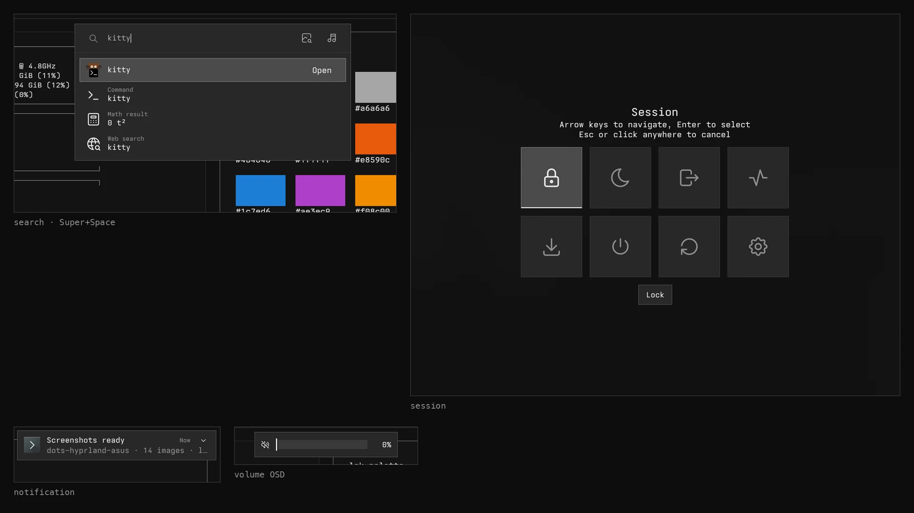
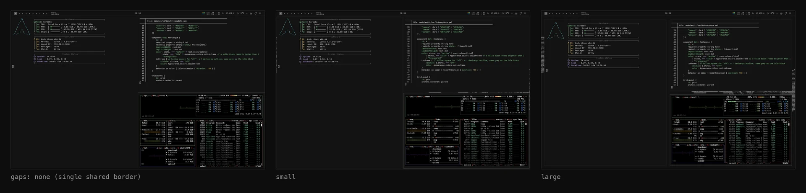
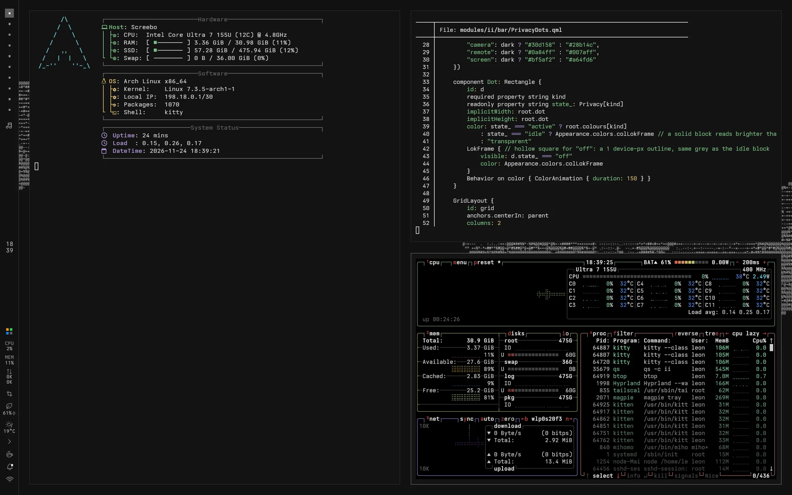

# lok style for ii (ASUS)

A greyscale, square, thin-line style on top of end-4's ii. Switch it with `appearance.style` = `lok` | `material`
(ii Settings, Style, or `config.json`). The lok palette is fixed and does not follow the wallpaper.

- ii code: every change checks `Appearance.lok`, so `material` keeps upstream's behaviour.
- Colours: `scripts/colors/lok/lok_palette.py` and `apply-lok.sh` (called by `switchwall.sh`). They also write
  `~/.config/hypr/custom/lok.lua` (generated: rounding 0, 1 px grey border, no shadow), which `custom/general.lua` loads.
- Icons: `fonts/LokIcons*.ttf`, installed to `~/.local/share/fonts/lok-icons/`. They are Tabler Icons 300/200 (MIT)
  with Material Symbols name ligatures. Rebuild with `icon-build/build_lok_icons.py <tabler ttf> "Lok Icons" LokIcons.ttf`.
- Wallpapers, installed to `~/Pictures/Wallpapers/`:
  - `wallpapers/lok-dots-{dark,light}.png`: a dot grid made for lok.
  - `wallpapers/wallhaven-7jmgey-lok.png` and `-lok-light.png`: the ASCII "Creation of Adam" hands, from wallhaven
    `7jmgey` (https://wallhaven.cc/w/7jmgey, 3840x2160, purple on dark). Wallhaven names files `wallhaven-<id>` and
    the id is unique. `-lok` is the greyscale version. `-lok-light` (2026-11-24) puts it on the light base with
    `v' = 226 - (v - 18) * 0.85` per pixel, where 226 is the lok-dots-light background.
- Back to the previous look: the tag `pre-lok-style-2026-11-12` with `asus/snapshots/2026-11-12-pre-lok/restore.sh`,
  or set the style to `material`.

## Gallery

To re-shoot after UI changes, run `demo/shoot.sh` (`prepare`, `dark`, `light`, `restore`) on the machine, then
`demo/compose.py` to crop and lay out the shots. It uses demo windows on workspace 1, mock notes and
notifications, a silent fake player and Hong Kong weather, and puts the real notes, notifications and config back
afterwards with a sha256 check.

### Desktop

The bar shows workspaces, now playing, the clock, the privacy dots, resources, screen snip, power mode with
battery, weather, the tray and status icons. Windows have 1 px frames over the ASCII hands wallpaper.

### Dark and light

Light mode keeps the layout and switches to the light wallpaper and the light lok tokens.

### Sidebars

The left sidebar has a scratchpad, resource cards with history, fan mode, battery, top processes and a status row
(camera, mic, Caffeine timer, keep the screen on). The right one has sliders, quick toggles, notifications as rows
and a calendar.

### Dialogs

A dashboard card opens a detail dialog (per-core CPU, temperature). Right-clicking a quick toggle opens its
settings; for Caffeine that is the duration presets and the keep-the-screen-on switch.

### Bar popups

Hovering a bar item opens a card popup with a title rule. The privacy dots light up like the macOS indicators: mic
orange, camera green, remote (SSH) blue, screen sharing purple. Grey means idle and an outline means off.

### Colour pick in the screen snip

Press Super+Alt+S and hover: the loupe shows the pixel grid and the colour under the cursor. C copies `#RRGGBB`,
Shift switches to `rgb()`, and the arrow keys move by one pixel.

### Search, session, notification, OSD

### Window gaps

The tile cycles none, small and large. With none, neighbouring windows share one border and the focused window's
border is on top.

### Vertical bar

The same modules, stacked on the left edge.

